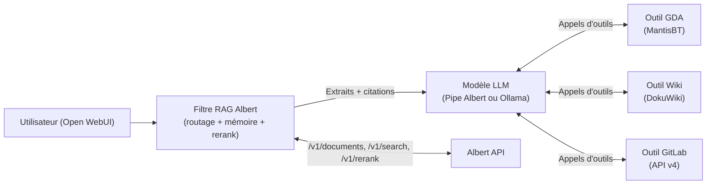

# Guide de prise en main — Open WebUI (RAG Albert, GDA, Wiki & GitLab)

Ce guide explique à l'équipe comment utiliser l'assistant **Open WebUI** connecté à :

- **Albert API (LLM & RAG)** : accès aux modèles de langage Albert et recherche documentaire intelligente multi-collections ;
- **GDA (MantisBT)** : consultation, recherche multi-critères et commentaire de tickets ;
- **Wiki (DokuWiki)** : recherche et lecture de pages de documentation interne ;
- **GitLab** : lecture de fichiers/classes dans les dépôts et requêtes directes sur l'API GitLab v4.

---

## Sommaire

1. [Vue d'ensemble](#1-vue-densemble)
2. [Démarrage rapide (Utilisateurs)](#2-démarrage-rapide-utilisateurs)
3. [Utiliser le RAG d'Albert API](#3-utiliser-le-rag-dalbert-api)
4. [Utiliser l'outil GDA (MantisBT)](#4-utiliser-loutil-gda-mantisbt)
5. [Utiliser l'outil Wiki (DokuWiki)](#5-utiliser-loutil-wiki-dokuwiki)
6. [Utiliser l'outil GitLab](#6-utiliser-loutil-gitlab)
7. [Combiner plusieurs sources dans une même question](#7-combiner-plusieurs-sources-dans-une-même-question)
8. [Guide Administrateur : Installation & Configuration](#8-guide-administrateur--installation--configuration)
9. [Dépannage & FAQ](#9-dépannage--faq)

---

## 1. Vue d'ensemble

Lorsque vous posez une question dans Open WebUI, deux mécanismes complémentaires entrent en jeu :

1. **Le filtre RAG Albert** s'exécute **automatiquement** avant l'envoi au modèle : il identifie le projet ou le document concerné, interroge les collections Albert API, rerank les extraits les plus pertinents et les injecte dans le contexte avec leurs citations.
2. **Les outils (GDA, Wiki, GitLab)** sont appelés **à la demande par le modèle** lorsque votre question porte sur un ticket, une page wiki ou du code source (à condition que les outils soient activés dans votre conversation).



> **Principe d'indépendance des sources** : les extraits RAG et les retours d'outils (GDA, Wiki, GitLab) sont traités comme des canaux indépendants. Une information absente du RAG peut tout à fait exister dans GDA, le Wiki ou GitLab (et inversement).

---

## 2. Démarrage rapide (Utilisateurs)

### Étape 1 — Renseigner votre clé API Albert personnelle

Si vous utilisez les modèles **Albert / ...** exposés via le Pipe Albert :

1. Ouvrez **Paramètres** → **Fonctions** (ou cliquez sur l'icône **Contrôles** en haut à droite du chat).
2. Sélectionnez la fonction **Albert** (`pipe_albert`).
3. Renseignez votre clé personnelle dans le champ **`API_KEY`** (`sk-...`).
4. Enregistrez.

> Sans clé personnelle renseignée, le chat affichera un message *« Accès refusé : veuillez entrer votre clé API Albert personnelle »*.

### Étape 2 — Choisir un modèle et activer les outils

1. En haut de la conversation, sélectionnez un modèle (ex. un modèle `Albert / ...`).
2. Cliquez sur l'icône **`+`** (ou le bouton **Outils**) dans la barre de saisie du chat et activez les outils dont vous avez besoin :
   - **MantisBT Advanced Search & Management** (GDA)
   - **DokuWiki HTTP Scraper Tool** (Wiki)
   - **GitLab Code Fetcher** (GitLab)

> **Astuce** : le filtre RAG Albert est généralement activé globalement par l'administrateur — vous n'avez pas besoin de le cocher manuellement à chaque conversation.

---

## 3. Utiliser le RAG d'Albert API

Le filtre `albert_rag_universal_filter.py` (v2.8.0) automatise la recherche dans vos collections Albert.

### 3.1 Routage intelligent par projet ou par document

Le filtre détermine automatiquement où chercher selon l'ordre de priorité suivant :

1. **Balises explicites** (`#reset`, `#all`, voir ci-dessous).
2. **Nom d'un document cité** dans votre question (ex. *« Que dit le fichier `spec_pasrau_2025.pdf` sur les arrondis ? »*) : le filtre cible alors **uniquement** ce document via `document_ids` et remonte jusqu'à 15 extraits (`TOP_K_TARGETED_DOC`).
3. **Mot-clé projet** présent dans votre question (ex. `PASRAU`, `PSIG`, `RH`, selon le mapping configuré) : le filtre cible la collection associée.
4. **Mémoire de conversation** (*Sticky Context*) : si vous posez une question de suivi sans répéter le nom du projet ou du document, le filtre réutilise automatiquement le dernier contexte actif (pendant 4 heures par défaut).
5. **Analyse de l'historique** : si la mémoire est vide (ex. après redémarrage), le filtre relit vos 6 dernières questions pour retrouver le sujet.
6. **Repli / Recherche multi-collections** : si aucun projet n'est détecté, il utilise la collection par défaut ou interroge toutes les collections configurées.

### 3.2 Balises de contrôle dans le chat

Vous pouvez insérer ces balises n'importe où dans votre message :

| Balise | Alias | Effet |
| --- | --- | --- |
| `#reset` | `#nouveau`, `#new` | Efface la mémoire du projet/document actif pour repartir sur un nouveau sujet dans le même chat. |
| `#all` | `#tous` | Force la recherche sur **toutes** les collections configurées. |

### 3.3 Comprendre les retours visuels

Pendant la génération, le filtre affiche des statuts dans l'interface :

- `🔎 Recherche Albert (PASRAU › spec_calcul.pdf)…` : recherche en cours sur le périmètre détecté.
- `12 extraits injectés (2 doc) depuis PASRAU · 📌 mémorisé (#reset pour changer)` : contexte injecté avec sources cliquables (citations) en bas de la réponse.

### 3.4 Exemples de prompts (RAG Albert)

- *« Quelles sont les règles de gestion PASRAU concernant les régularisations négatives ? »*
- *« Dans le document `guide_deploiement_psig`, quelles sont les étapes de rollback ? »*
- *(Question de suivi)* *« Et quels sont les prérequis avant la première étape ? »* → le filtre conserve automatiquement le document actif.
- *« `#reset` Maintenant, cherche dans la documentation RH la procédure de pose de congés. »*
- *« `#all` Où est mentionnée la norme d'encodage UTF-8 ? »*

---

## 4. Utiliser l'outil GDA (MantisBT)

L'outil `gda_tool.py` permet d'interagir avec MantisBT (GDA) directement depuis le chat.

### Capacités disponibles

| Fonction | Usage | Paramètres clés |
| --- | --- | --- |
| `get_ticket` | Lire le détail complet d'un ticket (description, statut, assignation, version cible, champs personnalisés, commentaires). | `issue_id` (numéro du ticket) |
| `search_issues` | Rechercher des tickets selon plusieurs critères. Scanne résumé, description, notes, versions cibles et champs personnalisés. | `query` (mots-clés séparés par des espaces, en **ET** logique), `project`, `target_version`, `status`, `page_size` (défaut 50, max 100), `max_pages` (défaut 1) |
| `list_projects` | Lister les projets Mantis accessibles avec leurs IDs et versions définies. | *(aucun)* |
| `add_comment` | Publier un commentaire (**public**) sur un ticket. | `issue_id`, `comment` |

### Bonnes pratiques

- **Donnez toujours l'ID du ticket si vous le connaissez** (ex. `#45380`, `ticket 45380`, `GDA 45380`) : le filtre guide alors immédiatement le modèle vers `get_ticket(issue_id=45380)`, ce qui est beaucoup plus rapide et précis qu'une recherche.
- **Élargir une recherche** : par défaut `search_issues` scanne 1 page de 50 tickets récents. Si un ticket plus ancien n'apparaît pas, demandez explicitement de scanner 2 ou 3 pages (`max_pages=3`) ou précisez le projet.
- **Attention à `add_comment`** : cette action publie une note **publique** dans GDA. Relisez toujours le texte proposé par l'assistant avant de confirmer la publication.

### Exemples de prompts (GDA)

- *« Fais-moi un résumé du ticket GDA #45380 et liste les derniers commentaires. »*
- *« Liste les projets disponibles sur GDA et leurs versions cibles. »*
- *« Cherche dans GDA les tickets du projet PASRAU en statut `assigned` contenant les mots `arrondi calcul` sur la version `2024.1` (scanne jusqu'à 3 pages). »*
- *« Ajoute sur le ticket #45380 le commentaire suivant : "Correctif validé en recette, prêt pour livraison." »*

---

## 5. Utiliser l'outil Wiki (DokuWiki)

L'outil `wiki_search_tool.py` permet de rechercher et de lire des pages de votre DokuWiki interne.

### Capacités disponibles

| Fonction | Usage | Détails |
| --- | --- | --- |
| `search_wiki` | Chercher des pages DokuWiki par mot-clé ou sigle. | Retourne jusqu'à 8 pages avec titre, ID (`namespace:page`) et aperçu. Si la recherche ne remonte rien, tente automatiquement un accès direct à la page portant ce nom. |
| `read_page` | Lire le contenu textuel nettoyé d'une page à partir de son ID. | Supprime les menus/fils d'Ariane et tronque à **5 000 caractères** pour préserver la fenêtre de contexte. |

### Bonnes pratiques

- Mentionnez explicitement **« wiki »** ou **« page wiki »** dans votre demande pour guider le modèle vers l'outil.
- Si une recherche ne retourne aucun résultat, essayez un **mot racine**, un **sigle** (ex. `RQL`) ou un terme **sans accent**.
- Si vous connaissez déjà l'identifiant DokuWiki d'une page (ex. `processus:validation`), donnez-le directement pour éviter l'étape de recherche.

### Exemples de prompts (Wiki)

- *« Cherche sur le wiki les pages qui parlent de `RQL`. »*
- *« Lis la page wiki `processus:validation` et résume-moi les étapes de mise en production. »*
- *« Vérifie sur le wiki s'il existe une procédure pour renouveler les certificats internes. »*

---

## 6. Utiliser l'outil GitLab

L'outil `gitlab_code_fetcher.py` permet d'explorer le code source (y compris des dépôts multi-modules) et d'interroger l'API REST v4 de GitLab.

### Capacités disponibles

| Fonction | Usage | Détails |
| --- | --- | --- |
| `get_file_content` | Récupérer le contenu d'un fichier ou d'une classe. | Accepte un **chemin complet** (`module/src/.../MaClasse.java`) ou un **simple nom de classe** (`PasrauNamingStrategy`). Enchaîne automatiquement : accès direct → recherche API Blobs → parcours récursif de l'arborescence (jusqu'à 15 pages). Supporte `project_id` et `branch` (branche, tag ou commit, `main` par défaut). |
| `gitlab_api_request` | Appeler n'importe quel endpoint de l'API GitLab v4 (`GET`, `POST`, `PUT`, `DELETE`). | Utile pour lister les **tags**, **branches**, **commits**, **merge requests**, **pipelines**, etc. Les listes de résultats sont limitées aux 10 premiers éléments. |

### Bonnes pratiques

- Précisez la **branche** ou le **tag** (ex. `develop`, `20271.1.0`) si vous ne voulez pas lire `main`.
- Précisez l'**ID du projet** si vous interrogez un autre dépôt que celui configuré par défaut (`DEFAULT_PROJECT_ID`).
- Mentionnez des mots-clés comme **« GitLab »**, **« code »**, **« dépôt »**, **« branche »**, **« commit »** ou **« tag »** pour inciter le modèle à utiliser l'outil.

### Exemples de prompts (GitLab)

- *« Récupère la classe `PasrauNamingStrategy` sur GitLab (branche `develop`) et explique comment sont construits les noms de fichiers. »*
- *« Liste les 5 derniers tags du projet GitLab 75. »*
- *« Montre-moi les derniers commits sur la branche `main` du dépôt GitLab. »*
- *« Vérifie le statut des derniers pipelines sur le projet GitLab 75. »*

---

## 7. Combiner plusieurs sources dans une même question

La force de cet environnement est de croiser **documentation (RAG / Wiki)**, **suivi d'anomalies (GDA)** et **code source (GitLab)** dans une seule conversation.

### Exemples de scénarios complets

- **Analyse d'une anomalie** :
  > *« Consulte le ticket GDA #45380, puis va lire la classe mentionnée sur la branche `develop` dans GitLab et compare son comportement avec la spécification PASRAU du RAG. »*
- **Préparation d'une mise en production** :
  > *« Liste les tickets GDA de la version cible `2025.1`, vérifie les derniers tags sur GitLab et rappelle-moi la check-list de livraison depuis le wiki. »*
- **Onboarding d'un nouveau membre** :
  > *« Cherche sur le wiki la page d'architecture du projet, puis récupère le fichier `pom.xml` sur GitLab pour m'expliquer les modules principaux. »*

---

## 8. Guide Administrateur : Installation & Configuration

Cette section s'adresse aux administrateurs qui déploient ou maintiennent l'instance Open WebUI.

### 8.1 Déploiement Docker

Le fichier `docker-compose.yml` déploie Open WebUI sur le port `3000` (mappé vers `8080` dans le conteneur) :

```bash
export OPENWEBUI_PASSWORD="mot-de-passe-admin-fort"
docker compose up -d
```

Points notables du `docker-compose.yml` :
- `WEBUI_AUTH: "true"` active l'authentification des utilisateurs.
- `AIOHTTP_CLIENT_TIMEOUT: 1800` évite les timeouts sur les requêtes longues.
- `OLLAMA_BASE_URL: "http://host.docker.internal:1234"` permet de connecter un serveur Ollama local si nécessaire.

### 8.2 Import des Fonctions et Outils dans Open WebUI

Dans l'interface d'administration Open WebUI :

1. **Fonctions** (*Panneau d'administration → Fonctions → `+`*) :
   - Importer `filtres/pipe_albert.py` (Pipe / Manifold pour les modèles Albert) et l'activer.
   - Importer `filtres/albert_rag_universal_filter.py` (Filtre RAG universel) et l'activer (globalement ou par modèle).
2. **Outils** (*Espace de travail → Outils → `+`*) :
   - Importer `tools/gda_tool.py`
   - Importer `tools/wiki_search_tool.py`
   - Importer `tools/gitlab_code_fetcher.py`

### 8.3 Configuration des Valves

#### A. Pipe Albert (`filtres/pipe_albert.py`)

| Valve | Type | Défaut | Description |
| --- | --- | --- | --- |
| `BASE_URL` | Admin | `https://albert.api.etalab.gouv.fr/v1` | URL de base de l'API Albert (sans `/` final). |
| `DISCOVERY_API_KEY` | Admin | `""` | Clé optionnelle utilisée uniquement pour lister les modèles (`GET /v1/models`). |
| `NAME_PREFIX` | Admin | `"Albert / "` | Préfixe affiché devant chaque modèle dans le menu déroulant. |
| `API_KEY` | **UserValve** | `""` | Clé API personnelle saisie par chaque utilisateur. |

#### B. Filtre RAG Albert (`filtres/albert_rag_universal_filter.py`)

| Valve | Défaut | Description |
| --- | --- | --- |
| `ALBERT_API_BASE_URL` | `https://albert.api.etalab.gouv.fr/v1` | URL de base de l'API Albert. |
| `ALBERT_API_KEY` | `""` | Clé API Albert utilisée par le filtre pour `/documents`, `/search` et `/rerank`. |
| `COLLECTION_ROUTING_JSON` | `{"pasrau": "266591", ...}` | Objet JSON associant chaque mot-clé (en minuscules) à son ID de collection Albert. |
| `DEFAULT_FALLBACK_COLLECTION` | `""` | Mot-clé projet par défaut si rien n'est détecté (laisser vide pour laisser `AUTO_SEARCH_ALL_ON_UNKNOWN` décider). |
| `AUTO_SEARCH_ALL_ON_UNKNOWN` | `True` | Interroge toutes les collections si aucun projet n'est identifié et que le fallback est vide. |
| `STICKY_CONTEXT` | `True` | Active la mémoire du projet/document actif par conversation. |
| `STICKY_TTL_SECONDS` | `14400` (4h) | Durée de conservation de la mémoire par conversation. |
| `HISTORY_SCAN_DEPTH` | `6` | Nombre de messages utilisateur relus en cas de mémoire vide. |
| `SEARCH_METHOD` | `semantic` | `semantic`, `lexical` ou **`hybrid`** (`hybrid` recommandé pour les acronymes métier). |
| `ENABLE_RERANK` | `True` | Active le reranking via `POST /v1/rerank`. |
| `RERANK_MODEL` | `BAAI/bge-reranker-v2-m3` | Modèle utilisé pour le reranking. |
| `RETRIEVAL_LIMIT` | `30` | Nombre de chunks bruts récupérés avant reranking (max `100`). |
| `TOP_K` / `TOP_K_TARGETED_DOC` | `12` / `15` | Nombre d'extraits injectés (standard vs document ciblé). |
| `RERANK_SCORE_THRESHOLD` | `-10.0` | Score minimal pour conserver un extrait après reranking. |
| `MAX_RAG_CONTEXT_CHARS` | `12000` | Budget maximal en caractères des extraits injectés (~4 car. = 1 token). À baisser pour les modèles locaux à petite fenêtre de contexte. |
| `MAX_HISTORY_MESSAGES` | `0` | Si `> 0`, ne conserve que les N derniers messages envoyés au LLM (`0` = désactivé). |
| `CACHE_TTL_SECONDS` | `600` | Durée de mise en cache de la liste des documents par collection (secondes). |
| `DEBUG_LOGS` | `True` | Affiche les traces `[Albert Filter DEBUG]` dans `docker logs`. |

#### C. Outil GDA (`tools/gda_tool.py`)

| Valve | Défaut | Description |
| --- | --- | --- |
| `MANTIS_REST_URL` | `https://gda.entrep.com/gda/api/rest` | URL de base de l'API REST MantisBT. |
| `MANTIS_API_TOKEN` | `""` | Jeton généré dans MantisBT via **Mon Compte → Jetons d'API**. |

#### D. Outil Wiki (`tools/wiki_search_tool.py`)

| Valve | Défaut | Description |
| --- | --- | --- |
| `BASE_URL` | `https://ton-dokuwiki.domaine.com/doku.php` | URL complète vers `doku.php`. |
| `COOKIE` | `""` | Cookie de session (ex. `DokuWiki=...; dw_token=...`) si le wiki nécessite une authentification. |
| `VERIFY_SSL` | `False` | Laisser `False` si le serveur utilise un certificat interne/autosigné. |

#### E. Outil GitLab (`tools/gitlab_code_fetcher.py`)

| Valve | Défaut | Description |
| --- | --- | --- |
| `GITLAB_URL` | `https://gitlab.riva` | URL de l'instance GitLab. |
| `GITLAB_TOKEN` | `""` | Personal Access Token (PAT) avec les scopes `read_api` et `read_repository`. |
| `DEFAULT_PROJECT_ID` | `75` | ID numérique (ou chemin URL-encodé) du projet GitLab par défaut. |
| `VERIFY_SSL` | `False` | Laisser `False` en cas de certificat interne/autosigné. |

---

## 9. Dépannage & FAQ

| Symptôme / Message d'erreur | Cause probable | Solution |
| --- | --- | --- |
| *« Accès refusé : veuillez entrer votre clé API Albert personnelle »* | La `UserValve` `API_KEY` du Pipe Albert est vide. | Renseigner sa clé dans *Paramètres → Fonctions → Albert* (ou via l'icône Contrôles du chat). |
| L'assistant continue de répondre sur un ancien document / projet | Le *Sticky Context* (mémoire de conversation) est toujours actif. | Ajouter `#reset` dans votre prochain message (ou ouvrir une nouvelle conversation). |
| Aucun extrait RAG n'est trouvé sur un acronyme métier | `SEARCH_METHOD` est sur `semantic`. | Passer `SEARCH_METHOD` à `hybrid` dans les Valves du filtre Albert. |
| L'assistant n'appelle pas GDA / Wiki / GitLab | Outil non activé dans le chat ou intention trop implicite. | Vérifier que l'outil est coché dans le chat et mentionner explicitement `GDA` / `ticket #...`, `wiki` ou `GitLab`. |
| *« Authentification requise. Configure le COOKIE »* (Wiki) | Le cookie de session DokuWiki est absent ou expiré. | Récupérer un cookie de session valide depuis le navigateur et mettre à jour la Valve `COOKIE`. |
| *« `MANTIS_API_TOKEN` / `GITLAB_TOKEN` non configuré »* | Token manquant dans les Valves de l'outil. | Renseigner le jeton dans *Espace de travail → Outils → Valves*. |
| Réponses lentes ou tronquées avec un modèle local (Ollama) | Contexte trop volumineux. | Réduire `MAX_RAG_CONTEXT_CHARS` (ex. `6000`) et définir `MAX_HISTORY_MESSAGES` (ex. `10`) dans les Valves du filtre. |
| Besoin de diagnostiquer le routage RAG | Comportement inattendu du filtre. | Vérifier que `DEBUG_LOGS=True` puis consulter `docker logs -f OpenwebUI` (préfixe `[Albert Filter DEBUG]`). |
