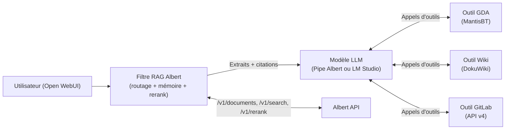

# Guide de prise en main — Open WebUI (RAG Albert, GDA, Wiki & GitLab)

Ce guide explique à l'équipe comment utiliser l'assistant **Open WebUI** connecté à :

- **Albert API (LLM & RAG)** : accès aux modèles de langage Albert (avec *function calling* natif) et recherche documentaire intelligente multi-collections ;
- **GDA (MantisBT)** : consultation, recherche multi-critères sans accents et commentaire de tickets (avec confirmation) ;
- **Wiki (DokuWiki)** : recherche et lecture de pages de documentation interne (`export_raw` ou API JSON-RPC) ;
- **GitLab** : lecture de fichiers/classes (par plage de lignes), recherche plein texte dans le code (`search_code`) et requêtes sécurisées sur l'API GitLab v4.

> **Sécurité & identifiants personnels** : chaque utilisateur renseigne **ses propres clés et jetons** via les `UserValves` Open WebUI (aucun repli sur une clé partagée par défaut), et toute action d'écriture (commentaire Mantis, `POST`/`PUT`/`DELETE` GitLab) demande une **confirmation explicite** dans le chat.

---

## Sommaire

1. [Vue d'ensemble](#1-vue-densemble)
2. [Démarrage rapide (Utilisateurs)](#2-démarrage-rapide-utilisateurs)
3. [Utiliser le RAG d'Albert API](#3-utiliser-le-rag-dalbert-api)
4. [Utiliser l'outil GDA (MantisBT)](#4-utiliser-loutil-gda-mantisbt)
5. [Utiliser l'outil Wiki (DokuWiki)](#5-utiliser-loutil-wiki-dokuwiki)
6. [Utiliser l'outil GitLab](#6-utiliser-loutil-gitlab)
7. [Combiner plusieurs sources dans une même question](#7-combiner-plusieurs-sources-dans-une-même-question)
8. [Guide Administrateur : Installation & Configuration](#8-guide-administrateur--installation--configuration)
9. [Dépannage & FAQ](#9-dépannage--faq)

---

## 1. Vue d'ensemble

Lorsque vous posez une question dans Open WebUI, deux mécanismes complémentaires entrent en jeu :

1. **Le filtre RAG Albert** s'exécute **automatiquement** avant l'envoi au modèle : il identifie le projet ou le document concerné, interroge les collections Albert API avec votre clé personnelle, rerank les extraits les plus pertinents et les injecte dans le contexte avec leurs citations.
2. **Les outils (GDA, Wiki, GitLab)** sont appelés **à la demande par le modèle** lorsque votre question porte sur un ticket, une page wiki ou du code source (à condition que les outils soient activés dans votre conversation).



> **Principe d'indépendance des sources** : les extraits RAG et les retours d'outils (GDA, Wiki, GitLab) sont traités comme des canaux indépendants. Une information absente du RAG peut tout à fait exister dans GDA, le Wiki ou GitLab (et inversement).

---

## 2. Démarrage rapide (Utilisateurs)

### Étape 1 — Renseigner votre clé API Albert personnelle (une seule fois)

1. Ouvrez **Paramètres** → **Fonctions** (ou cliquez sur l'icône **Contrôles** en haut à droite du chat).
2. Sélectionnez la fonction **Albert API Pipe** (`pipe_albert`).
3. Renseignez votre clé personnelle dans le champ **`API_KEY`** (`sk-...`).
4. Enregistrez.

> **Réutilisation automatique** : le filtre RAG Albert lit automatiquement la clé `API_KEY` que vous avez saisie dans la Pipe Albert — inutile de la recopier dans le filtre (sauf si vous souhaitez utiliser une clé différente dans la `UserValve` `ALBERT_API_KEY` du filtre, ou si vous n'utilisez pas la Pipe Albert).
>
> Sans clé personnelle renseignée, la Pipe affiche *« Accès refusé : veuillez entrer votre clé API Albert personnelle »* et le filtre RAG désactive la recherche documentaire.

### Étape 2 — Renseigner vos jetons personnels pour les outils (GDA, GitLab, Wiki)

Chaque outil utilise vos identifiants personnels afin que vos droits réels (projets accessibles, signature des commentaires) soient respectés. Dans **Paramètres** → **Outils** (ou via l'icône **Contrôles** du chat) :

- **MantisBT Advanced Search & Management** (GDA) : renseignez **`MANTIS_API_TOKEN`** (généré dans MantisBT → *Mon Compte → Jetons d'API*).
- **GitLab Code Fetcher** (GitLab) : renseignez **`GITLAB_TOKEN`** (Personal Access Token avec les scopes `read_api` et `read_repository`, ou `api` si vous effectuez des écritures).
- **DokuWiki Search & Reader Tool** (Wiki) : selon la configuration de votre Wiki, renseignez **`COOKIE`** (cookie de session `DokuWiki=...`), **`WIKI_API_TOKEN`** (JWT JSON-RPC) ou le couple **`WIKI_USERNAME` / `WIKI_PASSWORD`** (HTTP Basic JSON-RPC).

### Étape 3 — Choisir un modèle et activer les outils

1. En haut de la conversation, sélectionnez un modèle (ex. un modèle `Albert / ...`).
2. Cliquez sur l'icône **`+`** (ou le bouton **Outils**) dans la barre de saisie du chat et activez les outils dont vous avez besoin :
   - **MantisBT Advanced Search & Management** (GDA)
   - **DokuWiki Search & Reader Tool (export_raw + JSON-RPC)** (Wiki)
   - **GitLab Code Fetcher (Multi-modules, Full-Text Code Search & Safe API)** (GitLab)

> **Astuce** : le filtre RAG Albert est généralement activé globalement par l'administrateur — vous n'avez pas besoin de le cocher manuellement à chaque conversation.

---

## 3. Utiliser le RAG d'Albert API

Le filtre `filtres/albert_rag_universal_filter.py` (v2.9.1) automatise la recherche dans vos collections Albert.

### 3.1 Routage intelligent par projet ou par document

Le filtre détermine automatiquement où chercher selon l'ordre de priorité suivant :

1. **Balises explicites** (`#reset`, `#all`, voir ci-dessous).
2. **Nom d'un document cité** dans votre question (ex. *« Que dit le fichier `spec_pasrau_2025.pdf` sur les arrondis ? »*) : le filtre cible alors **uniquement** ce document via `document_ids` et remonte jusqu'à 15 extraits (`TOP_K_TARGETED_DOC`).
3. **Mot-clé projet** présent dans votre question (ex. `PASRAU`, `PSIG`, `RH`, selon le mapping configuré) : le filtre cible la collection associée.
4. **Mémoire de conversation** (*Sticky Context*) : si vous posez une question de suivi sans répéter le nom du projet ou du document, le filtre réutilise automatiquement le dernier contexte actif (pendant 4 heures par défaut).
5. **Analyse de l'historique** : si la mémoire est vide (ex. après redémarrage), le filtre relit vos 6 dernières questions pour retrouver le sujet.
6. **Repli / Recherche multi-collections** : si aucun projet n'est détecté, il utilise la collection par défaut ou interroge toutes les collections configurées.

### 3.2 Balises de contrôle dans le chat

Vous pouvez insérer ces balises n'importe où dans votre message :

| Balise | Alias | Effet |
| --- | --- | --- |
| `#reset` | `#nouveau`, `#new` | Efface la mémoire du projet/document actif pour repartir sur un nouveau sujet dans le même chat. |
| `#all` | `#tous` | Force la recherche sur **toutes** les collections configurées. |

### 3.3 Comprendre les retours visuels

Pendant la génération, le filtre affiche des statuts dans l'interface :

- `🔎 Recherche Albert (PASRAU › spec_calcul.pdf)…` : recherche en cours sur le périmètre détecté.
- `12 extraits injectés (2 doc) depuis PASRAU · 📌 mémorisé (#reset pour changer)` : contexte injecté avec sources cliquables (citations) en bas de la réponse.

### 3.4 Exemples de prompts (RAG Albert)

- *« Quelles sont les règles de gestion PASRAU concernant les régularisations négatives ? »*
- *« Dans le document `guide_deploiement_psig`, quelles sont les étapes de rollback ? »*
- *(Question de suivi)* *« Et quels sont les prérequis avant la première étape ? »* → le filtre conserve automatiquement le document actif.
- *« `#reset` Maintenant, cherche dans la documentation RH la procédure de pose de congés. »*
- *« `#all` Où est mentionnée la norme d'encodage UTF-8 ? »*

---

## 4. Utiliser l'outil GDA (MantisBT)

L'outil `tools/gda_tool.py` (v3.0.1) permet d'interagir avec MantisBT (GDA) directement depuis le chat avec votre jeton personnel.

### Capacités disponibles

| Fonction | Usage | Paramètres clés |
| --- | --- | --- |
| `get_ticket` | Lire le détail complet d'un ticket (description tronquée proprement si très longue, statut, assignation, version cible, champs personnalisés et les **15 dernières notes** par défaut). | `issue_id` (numéro du ticket, ex. `45380` ou `#45380`) |
| `search_issues` | Rechercher des tickets selon plusieurs critères. Scanne résumé, description, notes, versions cibles et champs personnalisés, **insensible aux accents** avec **classement par pertinence**. | `query` (mots-clés, scorés par pertinence), `project`, `target_version`, `status`, `page_size` (défaut `100`, max `100`), `max_pages` (défaut `4`, max `10`) |
| `list_projects` | Lister les projets Mantis accessibles avec leurs IDs et versions définies. | *(aucun)* |
| `add_comment` | Publier une note sur un ticket après **fenêtre de confirmation interactive** dans le chat. | `issue_id`, `comment`, `view_state` (`"public"` par défaut ou `"private"`) |

### Bonnes pratiques

- **Donnez toujours l'ID du ticket si vous le connaissez** (ex. `#45380`, `ticket 45380`, `GDA 45380`) : le filtre guide alors immédiatement le modèle vers `get_ticket(issue_id=45380)`, ce qui est beaucoup plus rapide et précis qu'une recherche.
- **Élargir une recherche** : par défaut `search_issues` parcourt **4 pages de 100 tickets** (soit 400 tickets récents). Si un ticket plus ancien n'apparaît pas, demandez de monter jusqu'à `max_pages=10` ou précisez le projet.
- **Confirmation sur `add_comment`** : avant tout envoi vers Mantis, Open WebUI ouvre une boîte de confirmation affichant le numéro de ticket, la visibilité (`public` ou `private`) et l'aperçu du texte. Vous pouvez valider ou annuler en un clic.

### Exemples de prompts (GDA)

- *« Fais-moi un résumé du ticket GDA #45380 et liste les derniers commentaires. »*
- *« Liste les projets disponibles sur GDA et leurs versions cibles. »*
- *« Cherche dans GDA les tickets du projet PASRAU en statut `assigned` contenant les mots `arrondi calcul` sur la version `2024.1`. »*
- *« Ajoute sur le ticket #45380 un commentaire privé : "Correctif validé en recette, prêt pour livraison." »*

---

## 5. Utiliser l'outil Wiki (DokuWiki)

L'outil `tools/wiki_search_tool.py` (v3.0.0) permet de rechercher et de lire des pages de votre DokuWiki interne en mode **`export_raw`** (source wiki propre, avec repli HTML) ou via l'**API JSON-RPC** DokuWiki.

### Capacités disponibles

| Fonction | Usage | Détails |
| --- | --- | --- |
| `search_wiki` | Chercher des pages DokuWiki par mot-clé ou sigle. | Retourne jusqu'à **10 pages** avec titre, ID (`namespace:page`) et aperçu. Utilise JSON-RPC (`core.searchPages`) si configuré, sinon la recherche HTML DokuWiki. |
| `read_page` | Lire le contenu d'une page à partir de son ID (`namespace:page`). | Récupère le texte brut via `?do=export_raw` (ou `core.getPage` en JSON-RPC), tronqué à **6 000 caractères** (`MAX_OUTPUT_CHARS`) avec **pagination par `offset`** pour lire la suite d'une longue page sans rien perdre. |

### Bonnes pratiques

- Mentionnez explicitement **« wiki »** ou **« page wiki »** dans votre demande pour guider le modèle vers l'outil.
- Si une recherche ne retourne aucun résultat, essayez un **mot racine**, un **sigle** (ex. `RQL`) ou un terme **sans accent**.
- Si vous connaissez déjà l'identifiant DokuWiki d'une page (ex. `processus:validation`), donnez-le directement pour éviter l'étape de recherche.
- Si une page est tronquée, demandez simplement *« Lis la suite de cette page wiki »* : l'outil rappellera `read_page` avec le bon `offset`.

### Exemples de prompts (Wiki)

- *« Cherche sur le wiki les pages qui parlent de `RQL`. »*
- *« Lis la page wiki `processus:validation` et résume-moi les étapes de mise en production. »*
- *« Vérifie sur le wiki s'il existe une procédure pour renouveler les certificats internes. »*

---

## 6. Utiliser l'outil GitLab

L'outil `tools/gitlab_code_fetcher.py` (v3.0.0) permet d'explorer le code source (y compris des dépôts multi-modules), de faire des recherches plein texte et d'interroger l'API REST v4 de GitLab.

### Capacités disponibles

| Fonction | Usage | Détails |
| --- | --- | --- |
| `search_code` | Rechercher une chaîne, un nom de méthode, d'annotation ou d'erreur dans tout un dépôt GitLab (API `/search?scope=blobs`). | Retourne les fichiers et extraits correspondants avec numéros de ligne ; supporte `project_id` (numérique ou `groupe/projet`) et `branch`. |
| `get_file_content` | Récupérer le contenu d'un fichier ou d'une classe avec **numérotation des lignes** et coloration de langage. | Accepte un **chemin complet** (`module/src/.../MaClasse.java`) ou un **simple nom de classe** (`PasrauNamingStrategy`). Détecte automatiquement la **branche par défaut** du dépôt (`main`, `master`, `develop`…). Supporte **`start_line` / `end_line`** pour lire une portion précise d'un gros fichier. |
| `gitlab_api_request` | Appeler un endpoint de l'API GitLab v4 (`GET`, `POST`, `PUT`, `PATCH`, `DELETE`). | Utile pour lister les **tags**, **branches**, **commits**, **merge requests**, **pipelines**, etc. Toute méthode d'écriture (`POST`/`PUT`/`PATCH`/`DELETE`) déclenche une **fenêtre de confirmation** dans le chat (et nécessite `ALLOW_WRITE=True`). |

### Bonnes pratiques

- Si vous ne précisez pas de branche, l'outil détecte automatiquement la branche par défaut du dépôt (pas besoin de deviner entre `main` et `master`). Précisez la branche ou le tag (ex. `develop`, `20271.1.0`) pour cibler une autre référence.
- Vous pouvez passer soit l'**ID numérique** du projet (`75`), soit son **chemin complet** (`mon-groupe/mon-projet`).
- Pour trouver où est utilisée une constante ou une méthode avant de lire le fichier entier, demandez une recherche dans le code (`search_code`).
- Mentionnez des mots-clés comme **« GitLab »**, **« code »**, **« dépôt »**, **« branche »**, **« commit »** ou **« tag »** pour inciter le modèle à utiliser l'outil.

### Exemples de prompts (GitLab)

- *« Cherche dans le code GitLab où est utilisée la constante `TAUX_NEUTRE`. »*
- *« Récupère la classe `PasrauNamingStrategy` sur GitLab (branche `develop`) et explique comment sont construits les noms de fichiers. »*
- *« Lis les lignes 120 à 220 du fichier `service/CalculService.java` sur le projet `equipe/pasrau`. »*
- *« Liste les 5 derniers tags du projet GitLab 75 et vérifie le statut des derniers pipelines. »*

---

## 7. Combiner plusieurs sources dans une même question

La force de cet environnement est de croiser **documentation (RAG / Wiki)**, **suivi d'anomalies (GDA)** et **code source (GitLab)** dans une seule conversation.

### Exemples de scénarios complets

- **Analyse d'une anomalie** :
  > *« Consulte le ticket GDA #45380, puis cherche la méthode mentionnée dans le code GitLab (branche `develop`) et compare son comportement avec la spécification PASRAU du RAG. »*
- **Préparation d'une mise en production** :
  > *« Liste les tickets GDA de la version cible `2025.1`, vérifie les derniers tags sur GitLab et rappelle-moi la check-list de livraison depuis le wiki. »*
- **Onboarding d'un nouveau membre** :
  > *« Cherche sur le wiki la page d'architecture du projet, puis récupère le fichier `pom.xml` sur GitLab pour m'expliquer les modules principaux. »*

---

## 8. Guide Administrateur : Installation & Configuration

Cette section s'adresse aux administrateurs qui déploient ou maintiennent l'instance Open WebUI.

### 8.1 Déploiement Docker

Le fichier `docker-compose.yml` déploie Open WebUI sur le port `3000` (mappé vers `8080` dans le conteneur) :

```bash
export OPENWEBUI_PASSWORD="mot-de-passe-admin-fort"
docker compose up -d
```

Points notables et recommandations sur `docker-compose.yml` :
- `WEBUI_AUTH: "true"` active l'authentification des utilisateurs.
- `AIOHTTP_CLIENT_TIMEOUT: 1800` évite les timeouts sur les requêtes longues.
- **Modèle local LM Studio (port `1234`)** : LM Studio expose une API compatible **OpenAI** (et non Ollama). Si vous connectez LM Studio sur le port `1234`, préférez dans `environment` :
  ```yaml
  ENABLE_OLLAMA_API: "false"
  OPENAI_API_BASE_URL: "http://host.docker.internal:1234/v1"
  OPENAI_API_KEY: "lm-studio"
  ```
  *(La taille de fenêtre de contexte d'un modèle LM Studio se règle directement dans LM Studio, onglet Load / Context Length.)*

### 8.2 Import des Fonctions et Outils dans Open WebUI

Dans l'interface d'administration Open WebUI :

1. **Fonctions** (*Panneau d'administration → Fonctions → `+`*) :
   - Importer **`pipes/pipe_albert.py`** (v2.0.0 — Pipe / Manifold pour les modèles Albert) et l'activer.
   - Importer **`filtres/albert_rag_universal_filter.py`** (v2.9.1 — Filtre RAG universel) et l'activer (globalement ou par modèle).
2. **Outils** (*Espace de travail → Outils → `+`*) :
   - Importer **`tools/gda_tool.py`** (v3.0.1)
   - Importer **`tools/wiki_search_tool.py`** (v3.0.0)
   - Importer **`tools/gitlab_code_fetcher.py`** (v3.0.0)

### 8.3 Configuration des Valves

#### A. Pipe Albert (`pipes/pipe_albert.py` — v2.0.0)

| Valve | Type | Défaut | Description |
| --- | --- | --- | --- |
| `BASE_URL` | Admin | `https://albert.api.etalab.gouv.fr/v1` | URL de base de l'API Albert (sans `/` final). |
| `DISCOVERY_API_KEY` | Admin | `""` | Clé optionnelle utilisée uniquement pour lister les modèles (`GET /v1/models`). |
| `NAME_PREFIX` | Admin | `"Albert / "` | Préfixe affiché devant chaque modèle dans le menu déroulant. |
| `MODELS_CACHE_TTL_SECONDS` | Admin | `300` | Durée de mise en cache de la liste des modèles (avec repli sur la dernière liste connue en cas d'erreur réseau). |
| `REQUEST_TIMEOUT_SECONDS` | Admin | `300` | Timeout de lecture en secondes pour les générations longues. |
| `VERIFY_SSL` | Admin | `True` | Vérification du certificat TLS vers Albert API. |
| `API_KEY` | **UserValve** | `""` | Clé API personnelle saisie par chaque utilisateur (obligatoire ; réutilisée par le filtre RAG). |

#### B. Filtre RAG Albert (`filtres/albert_rag_universal_filter.py` — v2.9.1)

| Valve | Type | Défaut | Description |
| --- | --- | --- | --- |
| `ALBERT_API_BASE_URL` | Admin | `https://albert.api.etalab.gouv.fr/v1` | URL de base de l'API Albert. |
| `PIPE_FUNCTION_ID` | Admin | `""` | ID explicite de la Pipe Albert pour lire la clé utilisateur (`auto-détecté` depuis le préfixe du modèle ou `pipe_albert` si vide). |
| `ALBERT_API_KEY` | Admin | `""` | Clé API de secours administrateur (utilisée **uniquement** si `ALLOW_ADMIN_KEY_FALLBACK=True`). |
| `ALLOW_ADMIN_KEY_FALLBACK` | Admin | `False` | Si `False`, impose une clé personnelle (filtre ou Pipe) pour utiliser le RAG. |
| `VERIFY_SSL` | Admin | `True` | Vérification TLS vers Albert API. |
| `COLLECTION_ROUTING_JSON` | Admin | `{"pasrau": "266591", ...}` | Objet JSON associant chaque mot-clé (en minuscules) à son ID de collection Albert. |
| `DEFAULT_FALLBACK_COLLECTION` | Admin | `""` | Mot-clé projet par défaut si rien n'est détecté (laisser vide pour laisser `AUTO_SEARCH_ALL_ON_UNKNOWN` décider). |
| `AUTO_SEARCH_ALL_ON_UNKNOWN` | Admin | `True` | Interroge toutes les collections si aucun projet n'est identifié et que le fallback est vide. |
| `STICKY_CONTEXT` | Admin | `True` | Active la mémoire du projet/document actif par conversation. |
| `STICKY_TTL_SECONDS` | Admin | `14400` (4h) | Durée de conservation de la mémoire par conversation. |
| `HISTORY_SCAN_DEPTH` | Admin | `6` | Nombre de messages utilisateur relus en cas de mémoire vide. |
| `SEARCH_METHOD` | Admin | `hybrid` | `semantic`, `lexical` ou **`hybrid`** (`hybrid` par défaut, idéal pour les acronymes métier). |
| `ENABLE_RERANK` | Admin | `True` | Active le reranking via `POST /v1/rerank`. |
| `RERANK_MODEL` | Admin | `BAAI/bge-reranker-v2-m3` | Modèle utilisé pour le reranking. |
| `RETRIEVAL_LIMIT` | Admin | `30` | Nombre de chunks bruts récupérés avant reranking (max `100`). |
| `TOP_K` / `TOP_K_TARGETED_DOC` | Admin | `12` / `15` | Nombre d'extraits injectés (standard vs document ciblé). |
| `RERANK_SCORE_THRESHOLD` | Admin | `-10.0` | Score minimal pour conserver un extrait après reranking. |
| `MAX_RAG_CONTEXT_CHARS` | Admin | `12000` | Budget maximal en caractères des extraits injectés (~4 car. = 1 token). À baisser pour les modèles locaux à petite fenêtre de contexte. |
| `MAX_HISTORY_MESSAGES` | Admin | `0` | Si `> 0`, ne conserve que les N derniers messages envoyés au LLM (`0` = désactivé). |
| `CACHE_TTL_SECONDS` | Admin | `600` | Durée de mise en cache de la liste des documents par collection (isolé par clé API). |
| `DEBUG_LOGS` | Admin | `True` | Affiche les traces `[Albert Filter DEBUG]` dans `docker logs`. |
| `ALBERT_API_KEY` | **UserValve** | `""` | Surcharge personnelle optionnelle (si vide, le filtre lit automatiquement `API_KEY` dans la Pipe Albert). |

#### C. Outil GDA (`tools/gda_tool.py` — v3.0.1)

| Valve | Type | Défaut | Description |
| --- | --- | --- | --- |
| `MANTIS_REST_URL` | Admin | `https://gda.entrep.com/gda/api/rest` | URL de base de l'API REST MantisBT. |
| `MANTIS_API_TOKEN` | Admin | `""` | Jeton admin de secours (utilisé uniquement si `ALLOW_ADMIN_TOKEN_FALLBACK=True`). |
| `ALLOW_ADMIN_TOKEN_FALLBACK` | Admin | `False` | Si `False`, impose un jeton personnel par utilisateur. |
| `ALLOW_WRITE` | Admin | `True` | Autorise `add_comment` (toujours protégé par confirmation interactive dans le chat). |
| `VERIFY_SSL` | Admin | `False` | `False` par défaut pour instance interne sans certificat ; repasser à `True` si CA interne montée. |
| `MAX_OUTPUT_CHARS` | Admin | `8000` | Taille maximale d'une réponse retournée au LLM. |
| `MAX_TICKET_NOTES` | Admin | `15` | Nombre maximal de notes récentes renvoyées par `get_ticket`. |
| `CUSTOM_USER_AGENT` | Admin | `""` | User-Agent HTTP optionnel si un proxy/WAF filtre le client par défaut. |
| `MANTIS_API_TOKEN` | **UserValve** | `""` | Jeton API personnel MantisBT de l'utilisateur. |

#### D. Outil Wiki (`tools/wiki_search_tool.py` — v3.0.0)

| Valve | Type | Défaut | Description |
| --- | --- | --- | --- |
| `BASE_URL` | Admin | `https://ton-dokuwiki.domaine.com/doku.php` | URL complète vers `doku.php`. |
| `ACCESS_MODE` | Admin | `auto` | `auto` (JSON-RPC si configuré, sinon `export_raw`/HTML), `html` ou `jsonrpc`. |
| `JSONRPC_URL` | Admin | `""` | URL optionnelle vers `lib/exe/jsonrpc.php` (déduite de `BASE_URL` si vide en mode `jsonrpc`). |
| `COOKIE` | Admin | `""` | Cookie de session admin de secours (utilisé uniquement si `ALLOW_ADMIN_AUTH_FALLBACK=True`). |
| `ALLOW_ADMIN_AUTH_FALLBACK` | Admin | `False` | Si `False`, impose les identifiants personnels de l'utilisateur. |
| `VERIFY_SSL` | Admin | `False` | `False` par défaut pour instance interne sans certificat. |
| `MAX_OUTPUT_CHARS` | Admin | `6000` | Taille maximale par page lue (la suite reste accessible via `offset`). |
| `WIKI_API_TOKEN` | **UserValve** | `""` | Jeton JWT personnel pour l'API JSON-RPC DokuWiki. |
| `WIKI_USERNAME` / `WIKI_PASSWORD` | **UserValve** | `""` | Identifiants personnels (HTTP Basic pour JSON-RPC). |
| `COOKIE` | **UserValve** | `""` | Cookie de session personnel (ex. `DokuWiki=...`) pour le mode HTML/`export_raw`. |

#### E. Outil GitLab (`tools/gitlab_code_fetcher.py` — v3.0.0)

| Valve | Type | Défaut | Description |
| --- | --- | --- | --- |
| `GITLAB_URL` | Admin | `https://gitlab.riva` | URL de l'instance GitLab. |
| `GITLAB_TOKEN` | Admin | `""` | PAT admin de secours (utilisé uniquement si `ALLOW_ADMIN_TOKEN_FALLBACK=True`). |
| `ALLOW_ADMIN_TOKEN_FALLBACK` | Admin | `False` | Si `False`, impose un PAT personnel par utilisateur. |
| `DEFAULT_PROJECT_ID` | Admin | `75` | ID numérique ou chemin (`groupe/projet`) du projet GitLab par défaut. |
| `ALLOW_WRITE` | Admin | `True` | Autorise `POST`/`PUT`/`PATCH`/`DELETE` via `gitlab_api_request` (toujours avec confirmation). |
| `VERIFY_SSL` | Admin | `False` | `False` par défaut pour instance interne sans certificat. |
| `MAX_OUTPUT_CHARS` | Admin | `8000` | Taille maximale des extraits de code / réponses JSON retournés au LLM. |
| `GITLAB_TOKEN` | **UserValve** | `""` | Personal Access Token personnel de l'utilisateur (`read_api`, `read_repository`). |

---

## 9. Dépannage & FAQ

| Symptôme / Message d'erreur | Cause probable | Solution |
| --- | --- | --- |
| *« Accès refusé : veuillez entrer votre clé API Albert personnelle »* | La `UserValve` `API_KEY` du Pipe Albert est vide. | Renseigner sa clé dans *Paramètres → Fonctions → Albert API Pipe* (ou via l'icône Contrôles du chat). |
| *« Clé API Albert personnelle non renseignée … RAG désactivé »* | Aucune clé trouvée ni dans le filtre, ni dans la Pipe Albert (et `ALLOW_ADMIN_KEY_FALLBACK=False`). | Renseigner `API_KEY` dans la Pipe Albert (ou `ALBERT_API_KEY` dans le filtre). Si la Pipe a un ID personnalisé, renseigner `PIPE_FUNCTION_ID` côté admin. |
| *« Jeton API Mantis personnel manquant »* / *« Token GitLab personnel manquant »* | La `UserValve` de l'outil n'est pas renseignée. | Renseigner son jeton personnel dans *Paramètres → Outils* (ou via l'icône Contrôles du chat). |
| *« Authentification Wiki requise »* | Aucun `COOKIE`, token ou identifiant personnel configuré (ou cookie expiré). | Mettre à jour sa `UserValve` `COOKIE` (ou `WIKI_API_TOKEN` / `WIKI_USERNAME` + `WIKI_PASSWORD`). |
| *« Publication annulée par l'utilisateur »* / *« Requête … annulée »* | Vous avez refusé (ou fermé) la fenêtre de confirmation d'écriture. | Relancer la demande et cliquer sur **Confirmer** si l'action affichée est correcte. |
| L'assistant continue de répondre sur un ancien document / projet | Le *Sticky Context* (mémoire de conversation) est toujours actif. | Ajouter `#reset` dans votre prochain message (ou ouvrir une nouvelle conversation). |
| L'assistant n'appelle pas GDA / Wiki / GitLab | Outil non activé dans le chat ou intention trop implicite. | Vérifier que l'outil est coché dans le chat (`+` / Outils) et mentionner explicitement `GDA` / `ticket #...`, `wiki` ou `GitLab`. |
| Réponses lentes ou tronquées avec un modèle local (LM Studio) | Fenêtre de contexte trop petite ou contexte injecté trop volumineux. | Augmenter *Context Length* dans LM Studio, et/ou réduire `MAX_RAG_CONTEXT_CHARS` (ex. `6000`) et définir `MAX_HISTORY_MESSAGES` (ex. `10`) dans les Valves du filtre. |
| Besoin de diagnostiquer le routage RAG | Comportement inattendu du filtre. | Vérifier que `DEBUG_LOGS=True` puis consulter `docker logs -f OpenwebUI` (préfixe `[Albert Filter DEBUG]`). |
